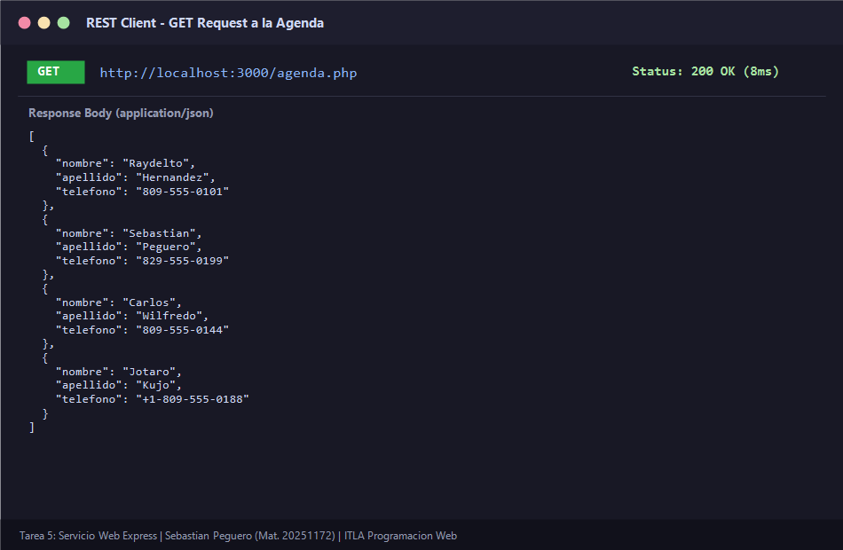
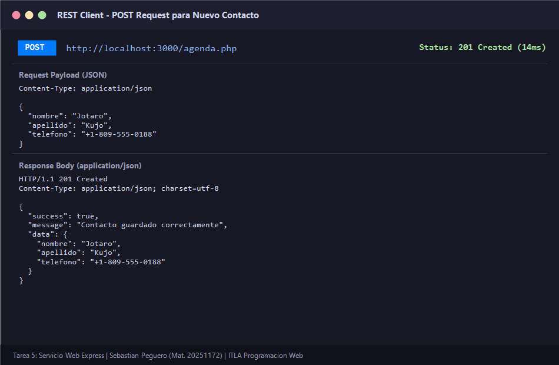
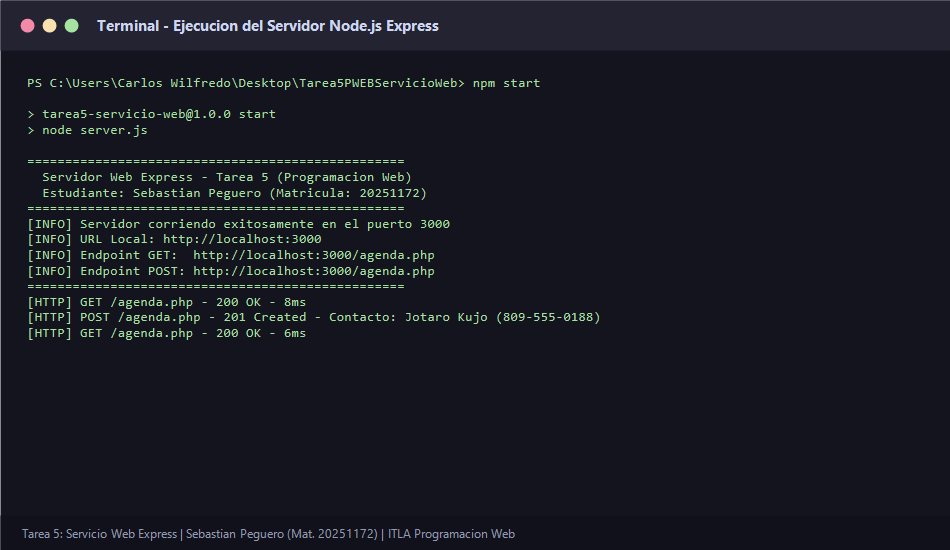

# Tarea 5: Servicio Web (8 puntos)

**Instituto Tecnológico de Las Américas (ITLA)**  
**Materia:** Programación Web  
**Docente:** Raydelto Hernández Perera  
**Estudiante:** Sebastian Peguero  
**Matrícula:** 20251172  

---

## 📌 Descripción de la Asignación

> "Haga un servicio Web utilizando la librería express de nodeJS que haga las dos operaciones básicas de listar y almacenar contactos realizados por el servicio `http://www.raydelto.org/agenda.php` el cual usted ha utilizado en las dos tareas anteriores."

Esta solución implementa un **Servicio Web RESTful en Node.js y Express** que replica de manera exacta el comportamiento, rutas y estructura de datos de la API original de la agenda (`http://www.raydelto.org/agenda.php`), añadiendo soporte para JSON persistente, validación de esquemas, manejo de errores HTTP y un cliente web con interfaz visual moderna.

---

## 🚀 Tecnologías y Arquitectura

- **Node.js** (v24+) y **Express.js** (v4.21+)
- **CORS** middleware habilitado para permitir consumo desde cualquier origen/cliente (fetch, React, Postman, etc.)
- **Persistencia Dual:** Almacenamiento en memoria para lectura ultrarrápida y persistencia en disco mediante `src/data/contacts.json`.
- **Patrón Arquitectónico en Capas (Separación de Responsabilidades):**
  - **`models/Contact.js`**: Entidad Contacto con validación de campos obligatorios (`nombre`, `apellido`, `telefono`).
  - **`controllers/contactController.js`**: Manejo de peticiones HTTP, extracción de datos y respuestas con códigos de estado HTTP apropiados (`200 OK`, `201 Created`, `400 Bad Request`, `500 Internal Server Error`).
  - **`services/contactService.js`**: Lógica de negocio y lectura/escritura en el sistema de persistencia.
  - **`routes/contactRoutes.js`**: Enrutador modular que expone tanto `/agenda.php` (para total compatibilidad con las Tareas #3 y #4) como `/api/contactos`.
  - **`public/`**: Cliente web para interactuar visualmente con el servicio web. Cumple con las buenas prácticas señaladas por el docente:
    - CSS organizado dentro de su respectivo directorio `public/css/styles.css`.
    - Script JavaScript invocado dentro del `<head>` utilizando el atributo moderno `defer`: `<script src="js/client.js" defer></script>`.

---

## 📖 Especificación de la API

### 1. Listar Contactos
- **Método:** `GET`
- **Ruta:** `/agenda.php` *(y `/api/contactos`)*
- **Código de Respuesta:** `200 OK`
- **Content-Type:** `application/json`
- **Respuesta de Ejemplo:**
```json
[
  {
    "nombre": "Raydelto",
    "apellido": "Hernandez",
    "telefono": "809-555-0101"
  },
  {
    "nombre": "Sebastian",
    "apellido": "Peguero",
    "telefono": "829-555-0199"
  }
]
```

### 2. Almacenar Contacto
- **Método:** `POST`
- **Ruta:** `/agenda.php` *(y `/api/contactos`)*
- **Content-Type:** `application/json`
- **Cuerpo de la Petición (Payload):**
```json
{
  "nombre": "Jotaro",
  "apellido": "Kujo",
  "telefono": "+1-809-555-0188"
}
```
- **Código de Respuesta:** `201 Created`
- **Respuesta de Ejemplo:**
```json
{
  "nombre": "Jotaro",
  "apellido": "Kujo",
  "telefono": "+1-809-555-0188"
}
```

---

## 📸 Evidencias de Funcionamiento

Las siguientes imágenes demuestran el funcionamiento verificado de los endpoints del servicio web:

### 1. Evidencia: Petición `GET /agenda.php` (Listado de Contactos en JSON)


---

### 2. Evidencia: Petición `POST /agenda.php` (Almacenamiento de Contacto Exitoso)


---

### 3. Evidencia: Inicialización y Logs del Servidor Express


---

## 💻 Instrucciones para Ejecutar el Proyecto

### Requisitos Previos
- [Node.js](https://nodejs.org/) (versión 18 o superior)
- [Git](https://git-scm.com/)

### Pasos de Instalación y Ejecución

1. **Clonar el repositorio:**
   ```bash
   git clone https://github.com/SebasPeguero/Tarea5ServicioWeb.git
   cd Tarea5ServicioWeb
   ```

2. **Instalar dependencias:**
   ```bash
   npm install
   ```

3. **Iniciar el servidor:**
   ```bash
   npm start
   ```

4. **Probar el servicio:**
   - **Interfaz Web del Cliente:** Abrir en el navegador [http://localhost:3000](http://localhost:3000)
   - **Endpoint GET:** [http://localhost:3000/agenda.php](http://localhost:3000/agenda.php)
   - **Endpoint POST:** Enviar petición `POST` a `http://localhost:3000/agenda.php` con cuerpo JSON vía Postman, cURL o mediante el formulario de la interfaz web.

---

## 📂 Estructura del Proyecto

```text
Tarea5ServicioWeb/
├── package.json
├── package-lock.json
├── server.js
├── README.md
├── .gitignore
├── screenshots/
│   ├── evidencia-get.png
│   ├── evidencia-post.png
│   └── evidencia-servidor.png
├── public/
│   ├── index.html
│   ├── jojo-logo.jpg
│   ├── css/
│   │   └── styles.css
│   └── js/
│       └── client.js
└── src/
    ├── controllers/
    │   └── contactController.js
    ├── data/
    │   └── contacts.json
    ├── models/
    │   └── Contact.js
    ├── routes/
    │   └── contactRoutes.js
    └── services/
        └── contactService.js
```
